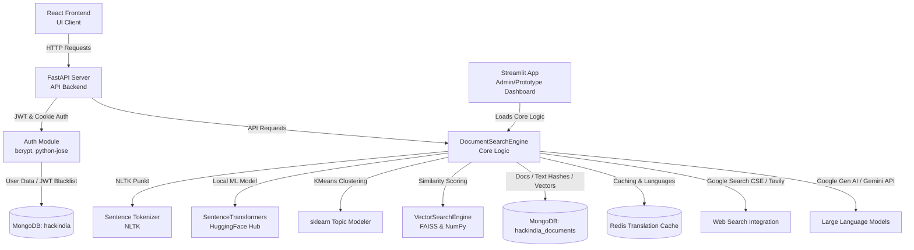
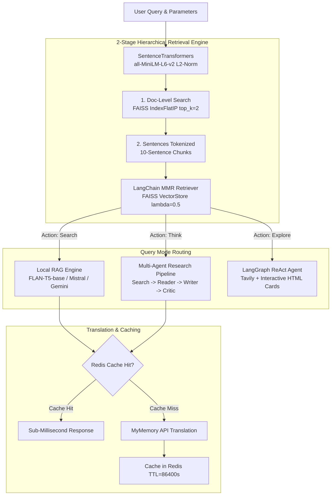
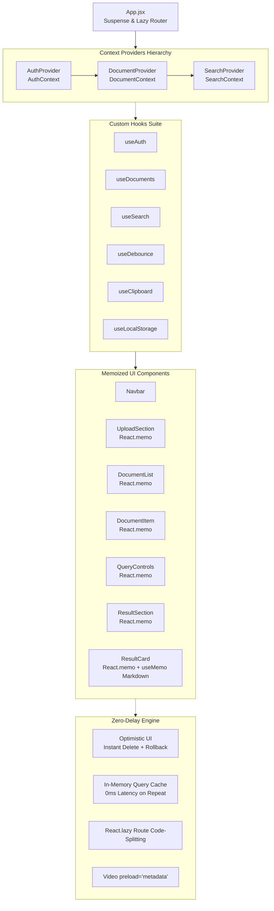

# summary.ai — Smart AI-Powered Document Search & RAG Engine

A production-ready, multi-tenant Document Search, Summarization, and RAG (Retrieval-Augmented Generation) platform. It features a modern React frontend, a Streamlit dashboard for prototyping, and a FastAPI backend powered by MongoDB, Redis, SentenceTransformers, and Google Gen AI (Gemini).

---

## 🗺️ System Architecture

This project employs a **dual-interface backend architecture** communicating with a unified core processing engine:



---

## 🛠️ Tech Stack & Interview Justifications

In interviews, you must justify *why* you chose specific technologies instead of alternatives:

| Component | Technology | Why This Choice? (Interview Answer) |
| :--- | :--- | :--- |
| **Backend Framework** | **FastAPI** | Selected over Flask/Django for its native asynchronous support (`async/await`), automatic OpenAPI/Swagger documentation generation, and high performance powered by Pydantic schema validation. |
| **Frontend Framework** | **Vite + React 18** | Chosen over Create React App (CRA) due to Vite's extremely fast HMR (Hot Module Replacement) powered by esbuild. React 18 concurrent features ensure responsive UI rendering. |
| **Frontend State Architecture** | **React Context API** | Segmented into domain-specific contexts (`AuthContext`, `DocumentContext`, `SearchContext`). Avoids external state bloat (Redux) while eliminating prop-drilling and unifying state lifecycle. |
| **Frontend Custom Hooks** | **Custom React Hooks** | Encapsulates logic and side-effects (`useAuth`, `useDocuments`, `useSearch`, `useDebounce`, `useClipboard`, `useLocalStorage`) for clean separation of concerns and maximum reusability. |
| **UI Performance Engine** | **React.memo & Client Caching** | Prevents keystroke delay via fine-grained memoization (`React.memo`, `useMemo` markdown parsing), in-memory AI query caching (`0ms` repeat retrieval), optimistic UI deletion, and route code-splitting (`React.lazy`). |
| **Authentication** | **JWT Bearer & Cookie** | Implemented dual-method auth. Bearer tokens allow secure machine-to-machine/client API integration, while HttpOnly cookies mitigate Cross-Site Scripting (XSS) attacks. Blacklisted tokens are auto-deleted via MongoDB TTL index. |
| **Primary Database**| **MongoDB** | A NoSQL document database matches our unstructured document data (PDF, DOCX, PPTX, image OCR results). It allows us to store varying metadata schemas per document type without migrations. |
| **Caching / Translation** | **Redis** | Chosen for lightning-fast, sub-millisecond response caching. In this application, it translates and caches query results to minimize redundant API calls to external translation APIs. |
| **Embeddings** | **SentenceTransformers**| Uses a local embedding model (like `all-MiniLM-L6-v2`) which guarantees zero data egress for sensitive documents and avoids subscription API costs while keeping response latency low. |
| **Vector Indexing** | **FAISS / Custom NumPy**| FAISS (Facebook AI Similarity Search) is ideal for efficient similarity search of dense vectors. When memory constraints apply, custom NumPy vector arithmetic is used as a lightweight fallback. |
| **LLM Provider** | **Google Gemini / FLAN-T5**| Google Gen AI is used for high-tier generative reasoning ("Think" mode), and a local FLAN-T5 model serves as a cost-effective, self-hosted option for document summarization. |

---

## ⚡ Core AI & Machine Learning Architecture

The AI processing backbone of `summary.ai` merges local NLP embedding pipelines with state-of-the-art Generative AI models and multi-agent systems:



### 1. Vector Embedding & Search Architecture
- **Embedding Model**: Uses `SentenceTransformers` (`all-MiniLM-L6-v2`) to produce 384-dimensional dense semantic vectors. Embeddings are L2-normalized so that inner product calculations directly equal cosine similarity ($A \cdot B = \cos(\theta)$).
- **Dual Vector Search Engine (`VectorSearchEngine`)**:
  - **Primary**: **FAISS `IndexFlatIP`** (Facebook AI Similarity Search) running C++ optimized vector inner-product comparisons.
  - **Lightweight Fallback**: Custom NumPy vector dot-product matrix multiplication (`np.dot(embeddings, q.T)`) for environments where native FAISS C++ binaries cannot be installed.
- **Hierarchical 2-Stage Retrieval**:
  1. *Stage 1 (Document Filtering)*: Compares the query embedding against entire document vectors to prune irrelevant files (`top_k=2`).
  2. *Stage 2 (Chunk Retrieval)*: Tokenizes candidate documents into sentences using `NLTK punkt`, aggregates them into chunks of 10 sentences (`chunk_size=10`, capped at 100 chunks/1000 sentences per doc to guarantee sub-second latency), and builds a temporary chunk index for fine-grained ranking.
- **LangChain MMR (Maximal Marginal Relevance) Retriever**:
  - Employs MMR retrieval with `lambda_mult=0.5`, optimizing for both **relevance** to the user prompt and **diversity** among selected chunks to prevent repetitive context.

### 2. Multi-Model RAG & Generation Engines
- **FLAN-T5-base (`google/flan-t5-base`)**:
  - A local conditional sequence-to-sequence model (`T5ForConditionalGeneration` + `T5Tokenizer`).
  - Configured with beam search (`num_beams=5`, `temperature=0.7`, `no_repeat_ngram_size=2`) for zero-cost, privacy-preserved on-premise summarization.
- **Google Gemini API (`gemini-flash-latest`)**:
  - Invoked for high-tier cognitive reasoning and structured analytical insights with formatted markdown and bullet points.
- **Mistral AI (`ChatMistralAI` + `mistral-medium-3-5`)**:
  - Powers concise context-grounded document excerpt answers and drives the multi-agent decision chains.

### 3. The Three Query Modes Explained

#### 🔎 1. Search Mode (MMR Retrieval & Summarization)
- Runs LangChain MMR chunk retrieval against the local vector database.
- Synthesizes an excerpt answer strictly grounded in the document context using FLAN-T5 or Mistral LLM.
- *Best for*: Precision factual questions directly answered in uploaded files.

#### 🧠 2. Think Mode (Autonomous Multi-Agent Research System)
Runs an end-to-end 4-stage multi-agent pipeline (`think/pipeline.py`):
1. **Search Agent (`build_search_agent`)**: Queries the Tavily Search API with the query and document excerpt to find real-time, authoritative web sources and URLs.
2. **Reader Agent (`build_reader_agent`)**: Scrapes the most relevant URL using BeautifulSoup (stripping scripts, styling, nav, and footer noise) to extract deep technical content.
3. **Writer Agent Chain (`writter_chain`)**: Combines document context, search snippets, and scraped content into a comprehensive structured report (Introduction, Key Findings, Conclusion, Sources).
4. **Critic Agent Chain (`critic_chain`)**: Rigorously audits the draft report for factual accuracy, gaps, logical consistency, source quality, and provides constructive feedback.

#### 🌐 3. Explore Mode (LangGraph ReAct Web Cross-Referencing)
- Executes an autonomous ReAct agent (`create_react_agent` via LangGraph) powered by `ChatMistralAI` and Tavily search tools.
- Formats external web discoveries directly into interactive HTML cards (`social-post`, `social-scroll-container`), providing live links and summaries for instant cross-referencing.

### 4. Topic Modeling & Unsupervised Clustering
- Computes dense embeddings for all uploaded files and applies **KMeans Clustering** (`scikit-learn`, $k=\min(\text{len}(\text{docs}), 3)$).
- Assigns thematic cluster IDs to documents, allowing users to discover semantic groupings without manual labeling.

### 5. Multi-Lingual Translation & Redis Caching Layer
- **RedisTranslationService**: Caches translation pairs in Redis using MD5 hashes (`trans:{src}:{target}:{md5}`) with a 24-hour TTL (`86400` seconds).
- **Supported Languages**: English (`en`), Hindi (`hi`), French (`fr`), Spanish (`es`), German (`de`), Japanese (`ja`), Korean (`ko`), Chinese (`zh`).
- **Resilience**: Automatically falls back to direct API translation if Redis is temporarily offline.

---

## 🔌 Complete API Contract Reference

### Authentication Routes

#### `POST /auth/register` (alias `/auth/signup`)
- **Body**: `{"name": "Developer", "email": "dev@example.com", "password": "securepassword"}`
- **Response**: `200 OK` with user creation confirmation.

#### `POST /auth/login`
- **Body**: `{"email": "dev@example.com", "password": "securepassword"}`
- **Response**: `{"access_token": "<JWT>", "token_type": "bearer"}` and sets an HttpOnly cookie.

#### `POST /auth/logout`
- **Headers**: `Authorization: Bearer <JWT>`
- **Response**: `{"message": "Successfully logged out"}`. Blacklists the token in MongoDB with a TTL index.

#### `GET /auth/me`
- **Headers**: `Authorization: Bearer <JWT>`
- **Response**: `{"name": "Developer", "email": "dev@example.com"}`

---

### AI & Document Operations (Requires `Authorization: Bearer <JWT>`)

#### `POST /api/upload`
- **Form Data**: `files: List[UploadFile]` (`.pdf`, `.docx`, `.pptx`, `.txt`, `.jpg`, `.jpeg`, `.png`)
- **Response**: `{"success": true, "message": "Successfully uploaded 2/2 files", "uploaded_files": [...]}`

#### `POST /api/query`
- **Body**:
  ```json
  {
    "query": "What are the key conclusions in section 3?",
    "action": "think",
    "threshold": 0.35,
    "translate_to": "hi"
  }
  ```
- **Response**:
  ```json
  {
    "success": true,
    "message": "Generated insights for 1 relevant documents",
    "results": [
      {
        "document_name": "quarterly_report.pdf",
        "best_sentence": "Operating margins grew by 14% year over year.",
        "score": 0.78,
        "refined_insight": "...",
        "action_type": "think"
      }
    ],
    "action": "think",
    "query": "...",
    "translation": {
      "translated": true,
      "source_language": "en",
      "target_language": "hi",
      "cached": false
    }
  }
  ```

#### `GET /api/documents`
- **Response**: `{"total_documents": 5, "documents": [{"id": "...", "name": "...", "content_length": 14200}], "clusters": [...]}`

#### `DELETE /api/documents/{doc_id}`
- **Response**: `{"success": true, "message": "Document deleted successfully"}`. Deletes document from MongoDB and reloads in-memory cache.

#### `POST /api/documents/reload`
- **Response**: `{"success": true, "message": "Documents reloaded successfully", "document_count": 5}`

#### `GET /api/languages`
- **Response**: `{"languages": {"en": "English", "hi": "Hindi", ...}, "default": "en"}`

#### `GET /api/health`
- **Response**: `{"status": "healthy", "document_count": 5, "vector_engine_ready": true}`

#### `GET /ping`
- **Response**: `{"pong": true}`. Lightweight cold-start prevention ping called every 4 minutes by the frontend.

---

## 🖥️ Frontend Architecture, State Management & Performance Engine

The `summary.ai` frontend client is engineered for high-throughput AI document interactions, zero-latency rendering, and modular state management. It transitions away from fragmented local state and prop drilling to a decoupled, domain-driven **React Context API** architecture paired with **custom UI hooks** and a zero-delay performance engine.

### 🌐 Frontend Architecture & Data Flow



---

### 📦 1. React Context API Architecture

Instead of bloated external state stores like Redux, the frontend employs domain-isolated React Contexts that prevent unnecessary re-rendering across unrelated branches of the DOM tree:

| Context | Provider | Managed State & Actions | Purpose & Optimizations |
| :--- | :--- | :--- | :--- |
| **`AuthContext`** | `<AuthProvider>` | `user`, `token`, `isAuthenticated`, `authLoading`, `login()`, `signup()`, `logout()`, `refreshUser()` | Centralizes session state across tabs, decodes JWT payloads, auto-validates expiration, and coordinates graceful 401 unauth resets without flashing protected UI. |
| **`DocumentContext`** | `<DocumentProvider>` | `documents`, `loadingDocs`, `uploading`, `uploadMsg`, `deletingId`, `error`, `languages`, `fetchDocuments()`, `fetchLanguages()`, `uploadFiles()`, `deleteDocument()` | Handles multipart file ingestion and **Optimistic Document Deletion** (instant item removal from state, with automated rollback on failure). Caches the languages list in a `useRef` to eliminate redundant network roundtrips. |
| **`SearchContext`** | `<SearchProvider>` | `prompt`, `setPrompt`, `action`, `setAction`, `language`, `setLanguage`, `result`, `loading`, `loadingMsg`, `error`, `queryError`, `shake`, `handleGenerate()`, `clearResult()` | Manages query state, dynamic timeout warnings ("AI is thinking..."), and houses the **In-Memory Query Cache** (`Map`) that provides **0ms instant responses** for repeated prompts and filter toggles. |

---

### 🎣 2. Custom Hooks Suite

The UI components do not interact directly with raw Axios calls or low-level DOM listeners. All logic is encapsulated in custom hooks:

- **`useAuth()`**: Provides components access to session data, current user profile, authentication state, and `login`/`signup`/`logout` triggers. Prevents unauthenticated routing flickers in `<ProtectedRoute>`.
- **`useDocuments()`**: Exposes document lists, file upload handlers, and optimistic deletion. Returns `languages` dictionary with zero redundant fetching.
- **`useSearch()`**: Exposes the query prompt, selected RAG action (`search`, `explore`, `think`), target language, and execution handlers. Contains the query caching engine and error shaking trigger.
- **`useDebounce(value, delay = 300)`**: Delays fast-changing state (e.g. search filter typing) until after a specified quiet window, preventing excessive renders and API spam.
- **`useClipboard(timeout = 2000)`**: Provides safe, leak-free clipboard copying (`copy(id, text)`, `isCopied(id)`). Automatically clears timeouts on component unmount to prevent React memory leak warnings.
- **`useLocalStorage(key, initialValue)`**: Safe browser storage synchronization with automatic JSON serialization, error boundaries, and reactive re-renders.

---

### ⚡ 3. Zero-Delay & Latency Optimization Engine

Document search and RAG platforms often suffer from UI lag and delayed rendering due to heavy AI inference times and large DOM trees. The following targeted optimizations eliminate delay across the entire stack:

| Bottleneck | Applied Engineering Solution |
| :--- | :--- |
| **Keystroke Lag in Textarea** | Decomposed Dashboard into `React.memo` subcomponents (`QueryControls`, `DocumentList`, `UploadSection`, `ResultSection`). Typing no longer triggers re-rendering of the document list or result cards. |
| **Markdown Parsing Lag** | `useMemo` compiles regex patterns strictly once per result item arrival, completely eliminating expensive regex evaluation during typing or state toggles. |
| **30-60s Repeat Queries** | Client-Side In-Memory Query Cache (`Map`) serves repeat prompts and action switches instantly with `0ms` delay without hitting backend inference. |
| **300ms Deletion Delay** | Optimistic UI: deletes document on screen immediately; rolls back only on API failure. |
| **Network Waterfall on Boot** | `Promise.allSettled` runs document and language requests concurrently in parallel on dashboard mount. |
| **Initial Bundle Bloat** | `React.lazy` & `Suspense` split pages into isolated micro-chunks (< 3 KB per page route), cutting initial JS load time. |
| **86MB Video Bandwidth Hog** | Added `preload="metadata"` and error boundary fallbacks to background video tags to prevent media bandwidth starvation. |

---

### 📂 4. Frontend Component & Directory Map

```text
frontend/src/
├── App.jsx                     # Top-level routing, Suspense boundaries & Context tree
├── main.jsx                    # Vite entry point
├── context/
│   ├── AuthContext.jsx         # Global auth state, JWT validation, login/logout
│   ├── DocumentContext.jsx     # Document collection, optimistic delete, languages
│   └── SearchContext.jsx       # Query state, actions, in-memory cache, AI search
├── hooks/
│   ├── useAuth.js              # Hook for AuthContext
│   ├── useDocuments.js         # Hook for DocumentContext
│   ├── useSearch.js            # Hook for SearchContext
│   ├── useDebounce.js          # Value debouncing utility hook
│   ├── useClipboard.js         # Auto-reset clipboard copying hook
│   └── useLocalStorage.js      # Type-safe browser storage hook
├── components/
│   ├── Navbar.jsx              # Responsive header using useAuth
│   ├── ProtectedRoute.jsx      # Route guard with token expiry check & spinner
│   ├── common/
│   │   └── LoadingSpinner.jsx  # Reusable CSS spinner for Suspense & async actions
│   └── dashboard/
│       ├── UploadSection.jsx   # Memoized file upload dropzone & trigger
│       ├── DocumentList.jsx    # Memoized list of user documents
│       ├── DocumentItem.jsx    # Memoized document row with formatBytes
│       ├── QueryControls.jsx   # Memoized prompt input, actions & language select
│       ├── ResultSection.jsx   # Memoized container for search results
│       └── ResultCard.jsx      # Memoized card with useMemo regex markdown parser
├── pages/
│   ├── Home.jsx                # Landing hero with optimized video
│   ├── Login.jsx               # Auth page with useAuth
│   ├── Signup.jsx              # Registration page with strength meter & useAuth
│   └── Dashboard.jsx           # Zero-delay orchestrator page
├── styles/                     # Scoped CSS style sheets
└── utils/
    └── api.js                  # Axios instance, Bearer interceptor & keep-alive ping
```

---

---

## 🔥 Toughest Interview Q&As for summary.ai

### Q1: How does your FastAPI backend prevent CORS errors during runtime failures (e.g., a 500 error)?
> **Answer**: Standard FastAPI CORS middleware wraps route handlers but can fail to write headers if a crash occurs in the routing layer itself, causing the browser to block the error response. To fix this, I implemented a custom `ForceCORSMiddleware` (subclassing `BaseHTTPMiddleware`). It intercepts requests *before* the router, processes preflight `OPTIONS` requests immediately, and wraps the execution loop in a `try-except` block. If an exception occurs, it intercepts the 500 crash, converts it into a `JSONResponse`, and **explicitly injects CORS headers** (`Access-Control-Allow-Origin`, etc.) into the response header dictionary, ensuring the client receives the exact error details.

### Q2: Why pre-load the ML models in `startup_event`? How does it affect deploy times?
> **Answer**: Loading model weights (like SentenceTransformers or tokenizers) from disk to memory takes several seconds. If deferred until the first query, the first user experiences a heavy lag (10+ seconds) or an API timeout. I registered a startup event handler (`@app.on_event("startup")`) that calls `_get_text_model()` to pull and cache model files during the application spin-up. While this slightly increases container startup/cold-boot time on Vercel or Railway, it guarantees that all subsequent query API calls are processed instantly with sub-second latency.

### Q3: How do you handle token constraints and cost limits when passing document chunks to Google Gemini?
> **Answer**: We avoid passing the entire document. Instead, we use a selective chunking strategy:
> 1. Tokenize document text into individual sentences via NLTK.
> 2. Perform vector-based semantic search to find only the top matching sentences.
> 3. Retrieve only those matching sentences and their immediate neighbor sentences to preserve context.
> 4. Filter matches based on a strict similarity threshold (e.g., `0.35`).
> This limits the payload sent to the LLM to a few hundred words, reducing API costs, speeding up response times, and preventing context window overflows.

### Q4: If the database runs out of connections or becomes sluggish under heavy search loads, how would you scale this architecture?
> **Answer**: Currently, MongoDB handles metadata and document storage while embeddings are loaded into memory to build a local vector index on startup. To scale this:
> 1. **Dedicated Vector Database**: Migrate vector searching from local memory/FAISS to a managed vector store like Qdrant, Pinecone, or Milvus. This offloads the mathematical calculation of cosine similarities from the application nodes.
> 2. **Caching**: Store repetitive user queries and corresponding answers in a Redis caching layer using a hash key of the query.
> 3. **Background Ingestion**: Offload document ingestion and embedding computation to an asynchronous task queue (like Celery with RabbitMQ) so the web server doesn't block while parsing large documents.

### Q5: Why did you choose React Context API over external state libraries like Redux Toolkit or Zustand?
> **Answer**: For `summary.ai`, state is naturally domain-partitioned into authentication (`AuthContext`), file management (`DocumentContext`), and search execution (`SearchContext`). Introducing Redux would add unnecessary boilerplate (actions, reducers, store configuration) and increase JavaScript bundle payload for code that does not require complex middleware or time-travel debugging. By segmenting state into three focused React Contexts and wrapping only the consumers that need that specific state, we achieve complete state decoupling without triggering cascading global re-renders.

### Q6: How did you eliminate keystroke delay when typing in the search box?
> **Answer**: The original monolithic dashboard kept input prompt state at the root level of `Dashboard.jsx`. Every keystroke in the `<textarea>` caused the parent component to re-render, forcing the entire document list to re-render and re-evaluating regex parsing on all markdown search results on each keypress. I solved this by:
> 1. Extracting `<QueryControls />`, `<DocumentList />`, and `<ResultSection />` into separate memoized components wrapped in `React.memo`.
> 2. Memoizing formatted HTML using `useMemo` in `<ResultCard />` so regular expression markdown replacement only executes when search results change, not on input keystrokes.
> 3. Supplying stable callback references with `useCallback` to prevent unnecessary prop-change re-renders.

### Q7: How does your Optimistic UI implementation work, and how does it handle failure?
> **Answer**: When a user clicks delete on a document, waiting for network latency (~200–500ms) causes noticeable UI sluggishness. With optimistic updates in `DocumentContext`, we:
> 1. Snapshot the current `documents` list.
> 2. Immediately filter the deleted document out of the React state array, updating the DOM in `< 1ms`.
> 3. Dispatch the asynchronous `DELETE /api/documents/:id` HTTP request in the background.
> 4. If the promise resolves successfully, the deletion is finalized. If the network or server rejects the deletion, the `catch` block restores the snapshot back into state and displays a user error alert. This guarantees consistency while delivering a zero-delay experience.

### Q8: What is the purpose of the client-side in-memory query cache in `SearchContext`?
> **Answer**: LLM inference (RAG search, Google Gemini cognitive synthesis) is compute-heavy and introduces 2 to 10 seconds of processing latency per query. Users frequently switch between languages (e.g. toggling English to Hindi) or re-run queries they previously searched in the same session. In `SearchContext`, we maintain a `Map` cache keyed by `${query.toLowerCase()}:::${action}:::${language}`. If a matching query is found in memory, the result is returned synchronously with **0ms latency**, instantly rendering the cards while cutting redundant API load and LLM cost to zero.

### Q9: Why use LangChain MMR (Maximal Marginal Relevance) instead of traditional top-k Cosine Similarity for RAG chunk retrieval?
> **Answer**: Traditional cosine similarity retrieval returns the chunks with the highest dot product to the query vector. In dense documents (like legal contracts or technical manuals), the top-3 chunks are often repetitive variations of the same sentence, leading to redundant context that wastes LLM token space. LangChain's MMR retriever (`lambda_mult=0.5`) balances **relevance** to the query with **novelty/diversity** compared to already selected chunks. It iteratively picks chunks that have high similarity to the query but minimal similarity to previously retrieved chunks, providing the LLM with a diverse, holistic context window.

### Q10: How does the Multi-Agent Research Pipeline in "Think" mode work?
> **Answer**: In "Think" mode, `summary.ai` runs a 4-stage multi-agent orchestration pipeline (`think/pipeline.py`):
> 1. **Search Agent**: Receives the user question and extracted document context, queries Tavily Search API, and retrieves verified, recent web sources and URLs.
> 2. **Reader Agent**: Takes the top URL identified by the Search Agent and performs deep scraping using `BeautifulSoup` (cleaning HTML tags, scripts, and styling) to capture in-depth technical facts.
> 3. **Writer Chain**: Synthesizes the local document excerpt, search snippets, and scraped page text into a structured analytical report (Introduction, Key Findings, Conclusion, Sources).
> 4. **Critic Chain**: Evaluates the written report for factual correctness, logical coherence, missing angles, and source credibility, injecting objective feedback and refinements. This separation of generation and critique mirrors human peer review and eliminates LLM hallucinations.

### Q11: How does MongoDB compound indexing `(user_email, text_hash)` prevent multi-tenant collisions and redundant embedding computation?
> **Answer**: In a multi-tenant platform, different users may upload identical files (e.g., public tax guidelines). Storing documents globally by hash would cause data leakage between users, while ignoring hashes would result in redundant files and wasted embedding calculations when a user uploads the same file twice. We compute an MD5 `text_hash` of the cleaned unicode text and enforce a unique compound index on `(user_email, text_hash)`. This allows User A and User B to independently maintain the same document, but prevents User A from generating duplicate database records and re-computing 384-dimensional embeddings if they re-upload the same document.

### Q12: How does the dual FAISS / NumPy architecture ensure both high performance and seamless deployment across cloud platforms?
> **Answer**: FAISS is a native C++ library that accelerates high-dimensional inner-product search, but compiling its C++ wheel dependencies on lightweight serverless containers (like Vercel serverless or minimal Alpine images) frequently triggers deployment failures. In `VectorSearchEngine`, I built an intelligent abstraction:
> - If `faiss` is installed, it uses `faiss.IndexFlatIP` for sub-millisecond C++ vector lookups.
> - If `faiss` fails to import, it automatically falls back to an optimized vectorized NumPy dot product (`np.dot(embeddings, q.T)`).
> Both paths use L2-normalized embeddings, guaranteeing mathematically identical cosine similarity rankings while ensuring the platform runs reliably anywhere without OS-level C++ dependency locks.

---

## 🚀 How to Run the Project Locally

### Prerequisites
- Python 3.10+
- Node.js 16+
- MongoDB and Redis instances running.

### 1. Setup Environment Variables
Create a `.env` file at the root:
```env
MONGODB_URI=your_mongodb_connection_string
REDIS_HOST=localhost
REDIS_PORT=6379
GOOGLE_API_KEY=your_gemini_key
GOOGLE_API_KEY2=your_google_search_key
GOOGLE_CSE_ID=your_google_custom_search_engine_id
FRONTEND_URL=http://localhost:5173
JWT_SECRET_KEY=your_super_secret_jwt_key
```

### 2. Run Backend & Core Engine
To start the FastAPI backend:
```bash
# Create a virtual environment and install requirements
python -m venv venv
source venv/bin/activate
pip install -r requirements.txt

# Start the FastAPI backend
uvicorn backend.main:app --reload --port 8000
```

To run the Streamlit dashboard:
```bash
# Using the local startup script
chmod +x start_local.sh
./start_local.sh
```

### 3. Run Frontend Client
```bash
cd frontend
npm install
npm run dev
```
Open `http://localhost:5173` in your browser.
