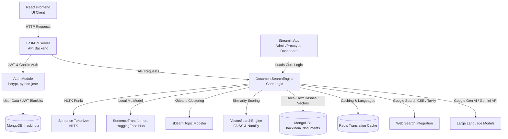

# summary.ai — Smart AI-Powered Document Search & RAG Engine

A production-ready, multi-tenant Document Search, Summarization, and RAG (Retrieval-Augmented Generation) platform. It features a modern React frontend, a Streamlit dashboard for prototyping, and a FastAPI backend powered by MongoDB, Redis, SentenceTransformers, and Google Gen AI (Gemini).

---

## 🗺️ System Architecture

This project employs a **dual-interface backend architecture** communicating with a unified core processing engine:



---

## 🛠️ Tech Stack & Interview Justifications

In interviews, you must justify *why* you chose specific technologies instead of alternatives:

| Component | Technology | Why This Choice? (Interview Answer) |
| :--- | :--- | :--- |
| **Backend Framework** | **FastAPI** | Selected over Flask/Django for its native asynchronous support (`async/await`), automatic OpenAPI/Swagger documentation generation, and high performance powered by Pydantic schema validation. |
| **Frontend Setup** | **Vite + React** | Chosen over Create React App (CRA) due to Vite's extremely fast HMR (Hot Module Replacement) powered by esbuild. React's component-driven model is perfect for maintaining modular search interfaces. |
| **Authentication** | **JWT Bearer & Cookie** | Implemented dual-method auth. Bearer tokens allow secure machine-to-machine/client API integration, while HttpOnly cookies mitigate Cross-Site Scripting (XSS) attacks. Blacklisted tokens are auto-deleted via MongoDB TTL index. |
| **Primary Database**| **MongoDB** | A NoSQL document database matches our unstructured document data (PDF, DOCX, PPTX, image OCR results). It allows us to store varying metadata schemas per document type without migrations. |
| **Caching / Translation** | **Redis** | Chosen for lightning-fast, sub-millisecond response caching. In this application, it translates and caches query results to minimize redundant API calls to external translation APIs. |
| **Embeddings** | **SentenceTransformers**| Uses a local embedding model (like `all-MiniLM-L6-v2`) which guarantees zero data egress for sensitive documents and avoids subscription API costs while keeping response latency low. |
| **Vector Indexing** | **FAISS / Custom NumPy**| FAISS (Facebook AI Similarity Search) is ideal for efficient similarity search of dense vectors. When memory constraints apply, custom NumPy vector arithmetic is used as a lightweight fallback. |
| **LLM Provider** | **Google Gemini / FLAN-T5**| Google Gen AI is used for high-tier generative reasoning ("Think" mode), and a local FLAN-T5 model serves as a cost-effective, self-hosted option for document summarization. |

---

## ⚡ Core Workflows Explained

### 1. Document Ingestion Pipeline
1. **File Upload**: Files are sent via `POST /api/upload` (or uploaded on the Streamlit sidebar).
2. **Text Extraction**: 
   - **PDFs**: Uses `PyMuPDF` (fitz) with `pdfplumber` fallback for high-quality text extraction (retaining spaces).
   - **DOCX**: Handled via `python-docx`.
   - **PPTX**: Handled via `python-pptx`.
3. **Cleansing**: Runs a unicode text normalization pipeline (`unicodedata.normalize('NFKD')`), strips control characters (`\x00-\x1F`), and normalizes spaces using regular expressions to ensure MongoDB BSON compatibility.
4. **Collision Prevention**: Computes an MD5 `text_hash` of the file text. Stores the document only if the compound index `(user_email, text_hash)` is unique. This permits multiple users to upload the same document without global duplication.
5. **Embedding**: The text is embedded and stored directly in MongoDB along with metadata.

### 2. Retrieval-Augmented Generation (RAG)
1. **Sentence Segmentation**: Documents are split into individual sentences using `NLTK`'s `sent_tokenize`.
2. **Semantic Search**: The user's query is converted to an embedding. We compute the cosine similarity (vector dot product) of the query embedding against the sentence embeddings.
3. **Retrieval**: Sentences matching above a similarity threshold (default `0.35`) are selected. For context retention, we grab the surrounding sentences (best matching sentence $\pm 1$ sentence context).
4. **Context Assembly**: The matching chunks are passed into the LLM context prompt.
5. **Response Generation**: The LLM synthesizes a concise response answering the query *only* based on the retrieved text context.

### 3. Topic Modeling & Clustering
- Runs **KMeans Clustering** (`scikit-learn`) on the document embeddings.
- It dynamically calculates topic groups (up to 3 clusters) and assigns a cluster ID to each document. This lets users explore their files grouped by thematic similarity.

---

## 🎯 The Three Query Actions

When a user submits a query, they can select one of three operational actions:

1. **🔎 Search (Retrieval & Summarization)**:
   - Finds semantic sentence matches in the local document base.
   - Summarizes the relevant chunks using the local RAG engine.
   - *Best for*: Extracting specific answers directly contained in the files.
2. **🧠 Think (Cognitive Synthesis)**:
   - Extracts document summaries matching the query.
   - Passes the summary and query to Google Gemini API.
   - Gemini applies multi-step reasoning, drawing connections, and refining findings.
   - *Best for*: Analytical deductions, reasoning over multiple documents, and extrapolating concepts.
3. **🌐 Explore (Cross-Referencing the Web)**:
   - Fetches the top-scoring sentence match from the local files.
   - Uses that sentence as contextual backing to query external search engines (Google Custom Search API or Tavily).
   - *Best for*: Verifying document facts against current live information or finding web sources related to your files.

---

## 🔌 API Contract Reference

### Authentication Routes

#### `POST /auth/register`
- **Body**: `{"email": "user@example.com", "password": "securepassword", "name": "Name"}`
- **Response**: User document creation status.

#### `POST /auth/login`
- **Body**: `{"username": "user@example.com", "password": "securepassword"}` (standard OAuth2 form-data or JSON).
- **Response**: JWT token in JSON, and sets an HTTPOnly session cookie.

---

### AI & Search Routes (Required Header: `Authorization: Bearer <JWT>`)

#### `POST /api/upload`
- **Form Data**: `files: List[UploadFile]`
- **Response**: Status list showing upload successes or duplicate hash rejections.

#### `POST /api/query`
- **Body**:
  ```json
  {
    "query": "What is the company profit margin?",
    "action": "think",
    "threshold": 0.35,
    "translate_to": "es"
  }
  ```
- **Response**: Returns the RAG-generated text, matching documents, top score, and translation metadata.

#### `GET /api/documents`
- **Response**: List of uploaded documents, their upload timestamps, and topic clustering metadata.

---

## 🔥 Toughest Interview Q&As for summary.ai

### Q1: How does your FastAPI backend prevent CORS errors during runtime failures (e.g., a 500 error)?
> **Answer**: Standard FastAPI CORS middleware wraps route handlers but can fail to write headers if a crash occurs in the routing layer itself, causing the browser to block the error response. To fix this, I implemented a custom `ForceCORSMiddleware` (subclassing `BaseHTTPMiddleware`). It intercepts requests *before* the router, processes preflight `OPTIONS` requests immediately, and wraps the execution loop in a `try-except` block. If an exception occurs, it intercepts the 500 crash, converts it into a `JSONResponse`, and **explicitly injects CORS headers** (`Access-Control-Allow-Origin`, etc.) into the response header dictionary, ensuring the client receives the exact error details.

### Q2: Why pre-load the ML models in `startup_event`? How does it affect deploy times?
> **Answer**: Loading model weights (like SentenceTransformers or tokenizers) from disk to memory takes several seconds. If deferred until the first query, the first user experiences a heavy lag (10+ seconds) or an API timeout. I registered a startup event handler (`@app.on_event("startup")`) that calls `_get_text_model()` to pull and cache model files during the application spin-up. While this slightly increases container startup/cold-boot time on Vercel or Railway, it guarantees that all subsequent query API calls are processed instantly with sub-second latency.

### Q3: How do you handle token constraints and cost limits when passing document chunks to Google Gemini?
> **Answer**: We avoid passing the entire document. Instead, we use a selective chunking strategy:
> 1. Tokenize document text into individual sentences via NLTK.
> 2. Perform vector-based semantic search to find only the top matching sentences.
> 3. Retrieve only those matching sentences and their immediate neighbor sentences to preserve context.
> 4. Filter matches based on a strict similarity threshold (e.g., `0.35`).
> This limits the payload sent to the LLM to a few hundred words, reducing API costs, speeding up response times, and preventing context window overflows.

### Q4: If the database runs out of connections or becomes sluggish under heavy search loads, how would you scale this architecture?
> **Answer**: Currently, MongoDB handles metadata and document storage while embeddings are loaded into memory to build a local vector index on startup. To scale this:
> 1. **Dedicated Vector Database**: Migrate vector searching from local memory/FAISS to a managed vector store like Qdrant, Pinecone, or Milvus. This offloads the mathematical calculation of cosine similarities from the application nodes.
> 2. **Caching**: Store repetitive user queries and corresponding answers in a Redis caching layer using a hash key of the query.
> 3. **Background Ingestion**: Offload document ingestion and embedding computation to an asynchronous task queue (like Celery with RabbitMQ) so the web server doesn't block while parsing large documents.

---

## 🚀 How to Run the Project Locally

### Prerequisites
- Python 3.10+
- Node.js 16+
- MongoDB and Redis instances running.

### 1. Setup Environment Variables
Create a `.env` file at the root:
```env
MONGODB_URI=your_mongodb_connection_string
REDIS_HOST=localhost
REDIS_PORT=6379
GOOGLE_API_KEY=your_gemini_key
GOOGLE_API_KEY2=your_google_search_key
GOOGLE_CSE_ID=your_google_custom_search_engine_id
FRONTEND_URL=http://localhost:5173
JWT_SECRET_KEY=your_super_secret_jwt_key
```

### 2. Run Backend & Core Engine
To start the FastAPI backend:
```bash
# Create a virtual environment and install requirements
python -m venv venv
source venv/bin/activate
pip install -r requirements.txt

# Start the FastAPI backend
uvicorn backend.main:app --reload --port 8000
```

To run the Streamlit dashboard:
```bash
# Using the local startup script
chmod +x start_local.sh
./start_local.sh
```

### 3. Run Frontend Client
```bash
cd frontend
npm install
npm run dev
```
Open `http://localhost:5173` in your browser.
